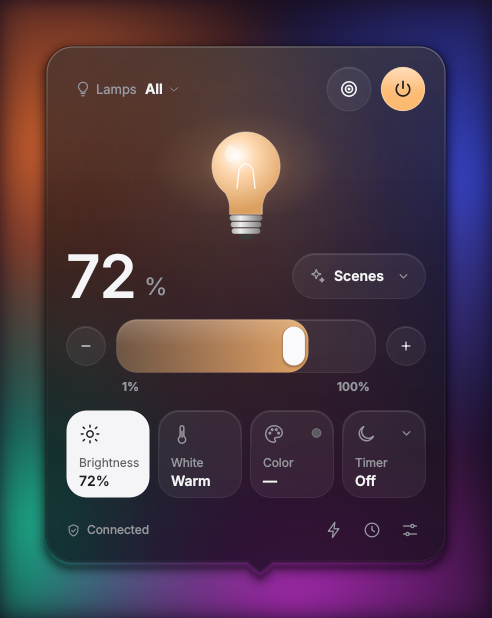
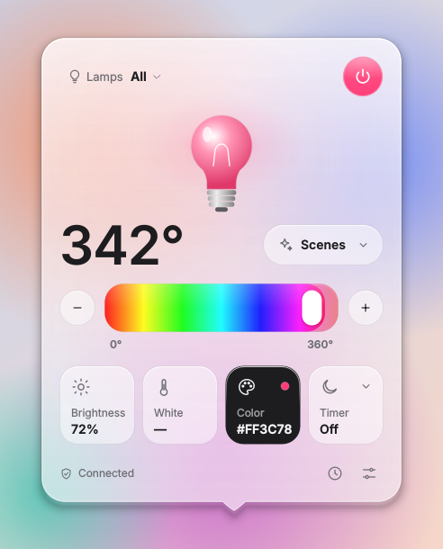
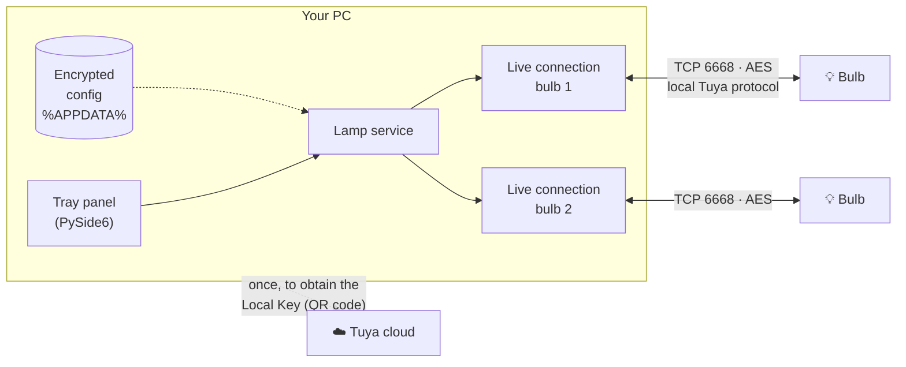
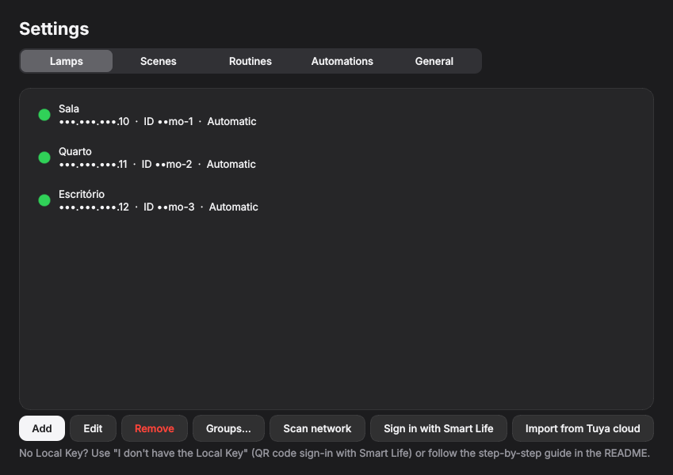
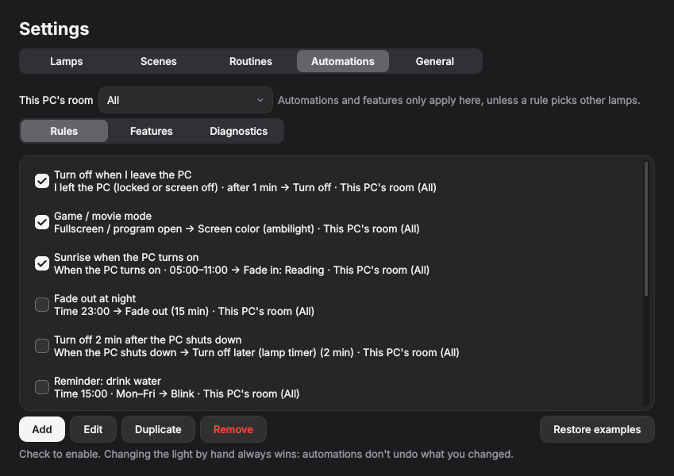

<div align="center">

# 💡 LampDesk

**Manage your Wi-Fi smart bulbs from the Windows system tray: instantly, over your local network, no cloud.**

Works with Wi-Fi bulbs from the Tuya/Smart Life ecosystem, from dozens of brands ([see examples](#compatible-bulbs)).

**English** · [Português](README.pt-BR.md)

[](https://github.com/edugaspars/lampdesk/actions/workflows/ci.yml)
[](LICENSE)





</div>

---

## Why it exists

Smart bulbs are great until you need them **while you're at your computer**. Grab the phone, unlock it, open the app, wait for it to load… just to dim the lights for a meeting or a movie.

**LampDesk** puts your bulbs **one click away**, right next to the Windows clock. It talks **directly to the bulb over your Wi-Fi**: no cloud round-trip, no lag, and it keeps working when the internet is down.

## Who it's for

- **Anyone with a Tuya-based Wi-Fi bulb**: the ones that work with the *Smart Life* and *Tuya Smart* apps. The same technology powers dozens of brands worldwide ([list of examples](#compatible-bulbs)).
- **People who work or game on a PC** and want to adjust the lights without reaching for the phone.
- **Privacy-minded users** who'd rather not depend on third-party servers for everyday control.
- **Tinkerers and developers** looking for a real-world Python tray app built on the local Tuya protocol.

> No coding required: download the latest release and follow the steps below.

## Features

| | |
|---|---|
| ⚡ **Real time** | Commands reach the bulb in milliseconds. Changes made through Alexa, the phone app or the wall switch show up in the panel instantly. |
| 🎛️ **Full control** | Power, brightness, white temperature (warm ↔ cool) and color (RGB). |
| 💡 **Multiple bulbs and groups** | Control each bulb, a group (e.g. Office) or all of them at once. |
| 🫧 **Glass look** | Dark and light themes with a frosted-glass panel that blurs what's behind it and glows in the color of the bulb. Mica background on Windows 11, plus a *Reduce transparency* option. |
| 🎬 **Scenes** | Reading, Relax, Focus, Night, **Ambilight** (follows the screen color), **Music** (follows the album cover)… plus your own. The panel shows each bulb's active scene. |
| ⏰ **Routines** | By time and weekday, or at **sunrise/sunset** with a minute offset. |
| 🌙 **Sleep timer** | "Turn off in 30 minutes". |
| 🤖 **Automations** | "When / If / Then" editor: turn off when the PC locks, game/movie mode in fullscreen with the screen color (ambilight), sunrise when the PC turns on, fade out, turn off 2 min after the PC shuts down, blinking reminders, global hotkeys. |
| 🎯 **Focus mode** | For work, study and meetings: a work light and no automatic changes (only the pomodoro blinks). Button next to the power button, plus work hours (Mon–Fri, 8:00 to 17:50). |
| 💬 **Discord mode** | A message blinks blue, a call blinks green and white (reads Windows notifications). |
| 🌅 **Daylight cycle and pomodoro** | Cool light by day and warm at night, a pomodoro that blinks at the end of each step, and a vacation pause. The Ambilight and Music scenes toggle from the ⚡, and the panel footer shows what is controlling the light (with ✕ to stop). |
| 🔐 **Privacy** | IPs and keys stay **encrypted** on your PC only. Nothing goes into the repository. |
| 🔑 **Easy setup** | Finds the bulbs on your network and gets the key with a **QR code** scanned in Smart Life. |
| 🌎 **English and Portuguese** | Follows your system language; switch anytime. |
| 🚀 **Starts with Windows** | Sits quietly in the tray, ready to go. |

## Compatible bulbs

Works with **Wi-Fi bulbs** on the Tuya platform: the ones that pair with the **Smart Life** or **Tuya Smart** app. Many brands use this platform, for example:

| In Brazil | Worldwide |
|---|---|
| Positivo Casa Inteligente | Teckin |
| Multilaser Liv | Gosund |
| Ekaza | Lumary |
| Elgin | Feit Electric |
| | Treatlife |
| | Moes |
| | Nedis SmartLife |
| | Globe Electric |
| | Merkury / Geeni |
| | Calex |

> The list is only examples: brands switch suppliers over time. The test that matters is **whether the bulb works in the Smart Life app**. Zigbee-only or Bluetooth-only bulbs don't work (the app talks over Wi-Fi).

## How it works



1. **Local protocol.** Bulbs built on the Tuya platform accept commands on the local network (TCP port 6668), AES-encrypted with a per-bulb key called the **Local Key**. The app uses [tinytuya](https://github.com/jasonacox/tinytuya) to build those messages and supports protocol versions 3.1 to 3.5.
2. **Live connection.** Each bulb keeps a connection open all the time, in its own thread:
   - commands are sent without waiting for a reply, so the panel updates instantly;
   - the bulb announces every state change, which keeps the app in sync with Alexa and the phone app;
   - a ping every 10 s keeps the connection alive, and it reconnects on its own if the network drops.
3. **The Local Key.** It is created when the bulb is paired in the phone app and stored in the Tuya cloud. LampDesk fetches it **only once**, through a QR code you scan in the Smart Life app. After that, the cloud is no longer used.
4. **Your data.** The IP, Device ID and Local Key live in a single file under `%APPDATA%\LampDesk`:
   - on Windows it is encrypted with **DPAPI**, so only your user account can open it;
   - on Linux it is encrypted with **Fernet (AES)**, with the key stored in the system keyring.

## Installation

### Windows (recommended)

1. Download `LampDesk.exe` from the **[latest release](https://github.com/edugaspars/lampdesk/releases/latest)**.
2. Move it to a permanent folder, for example `%LOCALAPPDATA%\Programs\LampDesk`.
3. Run it. If Windows SmartScreen warns you, click **More info › Run anyway** (the executable has no paid code signature).
4. If the firewall asks, allow it on **Private networks**. This is what lets the app find bulbs on your network.

The 💡 icon appears next to the clock. If it's hidden, click the **^** arrow and drag it onto the taskbar.

### Linux

Download `LampDesk-linux-x86_64` from the **[latest release](https://github.com/edugaspars/lampdesk/releases/latest)**, then:

```bash
chmod +x LampDesk-linux-x86_64
./LampDesk-linux-x86_64
```

On **GNOME**, the tray icon requires the *AppIndicator and KStatusNotifierItem Support* extension.

<details>
<summary><b>Build the executable yourself</b></summary>

Requires [Python 3.10+](https://www.python.org/downloads/).

```bat
git clone https://github.com/edugaspars/lampdesk.git
cd lampdesk
build_windows.bat
```

The script creates a virtual environment, runs the tests and produces `dist\LampDesk.exe`. On Linux, `python scripts/build.py` produces `dist/LampDesk-linux-x86_64`.
</details>

<details>
<summary><b>Run from Python (Windows or Linux)</b></summary>

```bash
pip install -r requirements.txt
python -m lampdesk          # on Windows, use pythonw to avoid a console window
python -m lampdesk --demo   # simulated bulbs, to try the app
```

On Linux with **GNOME**, the tray icon requires the *AppIndicator and KStatusNotifierItem Support* extension.
</details>

## Getting started

### 1. The bulb must be in the Smart Life app

QR-code sign-in works with **Smart Life** or **Tuya Smart** accounts. If your bulb is in its **brand's own app** (an app named after the manufacturer), move it over (takes about 10 minutes):

1. In the brand's app, open the bulb and choose **Remove device**.
2. Flip the wall switch off and on 3 times until the bulb **blinks quickly**.
3. In **Smart Life**, tap **+ › Add device**, with the phone on **2.4 GHz** Wi-Fi.
4. **Alexa/Google:** enable the **Smart Life** skill and ask it to discover devices.

### 2. Add the bulb to LampDesk

1. Click the 💡 icon, then **Add lamp**.
2. Use **Scan network** to fill in the IP and the Device ID.
3. Click **I don't have the Local Key**:
   - in Smart Life, copy your **User Code** from *Me › ⚙ Settings › Account and Security*;
   - paste it in LampDesk and click **Generate QR code**;
   - in Smart Life, open the **Me** tab, tap the scanner icon (top right), scan and confirm on the phone.
4. Click **Test connection**, then **Save**. Done!



> 💡 **Tip:** reserve a fixed IP for each bulb in your router (DHCP reservation). If the IP ever changes, **Scan network** updates the bulb you already added.

<details>
<summary><b>Alternative: the official Tuya developer platform</b></summary>

QR-code sign-in uses the same mechanism as Tuya's official **Home Assistant** integration (the `tuya-device-sharing-sdk` library). If Tuya ever disables it:

1. Create a free account at [iot.tuya.com](https://iot.tuya.com).
2. Go to **Cloud › Development › Create Cloud Project**:
   - Smart Home;
   - pick the data center that matches your app account (*Western America* for Brazil and the US).
3. Under **Devices › Link App Account**, scan the QR code with Smart Life.
4. Copy the **Access ID** and **Access Secret** from the *Overview* tab.
5. In LampDesk, use **Settings › Lamps › Import from Tuya cloud**.

Credentials are not saved.
</details>

## Usage

| Action | How |
|---|---|
| Open the panel | Left-click the 💡 icon |
| Turn all bulbs on/off | Middle-click the icon |
| Quick menu (bulbs, scenes, settings) | Right-click the icon |
| Change what the slider controls | Click the **Brightness**, **White** or **Color** cards |
| Pick an exact color | Click the **Color** card again |
| Routines and sunrise/sunset | The ⏰ icon in the panel footer |
| Focus mode (locks automations) | The 🎯 button next to the power button in the panel |
| Discord mode, Ambilight, Music, daylight cycle, pomodoro, vacation | The ⚡ icon in the panel footer (or **Automations** in the tray menu) |

### Automations

In **Settings › Automations** each rule has three parts:



- **When:** I left the PC (locked or screen off), fullscreen / program open, time, sunrise/sunset, when the PC turns on, when the PC shuts down, an app notification or a hotkey.
- **If:** weekdays, only between two times, only when it's dark, only with Discord mode on.
- **Then:** turn on, turn off, scene, color, brightness, blink, fade in/out, turn off later (the bulb's own timer), screen color (ambilight), pomodoro, toggle focus mode and other modes.

On first use the app asks for **this PC's room** (e.g. the Office group): automations and features only change those lamps, not the whole house (you can change it at the top of the tab). The tab comes with disabled examples: just check one. Lasting rules (PC locked, fullscreen) put the light back when they end, and **changing the light by hand always wins**: automations don't undo what you changed.

- **Turn off after the PC shuts down:** the app asks the bulb to switch itself off in N minutes (the same timer as in the Smart Life app), so it works with the PC off. If the PC turns back on first, the request is cancelled.
- **Discord and other apps:** the app reads the notifications Windows shows in the corner of the screen. Muted Discord channels create no notification and don't blink. The **Diagnostics** tab shows the last notification read and lets you simulate one.
- **Windows-only parts:** screen lock, fullscreen, notifications, global hotkeys, album cover and shutdown. On Linux, time rules, daylight cycle, the Ambilight scene and pomodoro work; the rest stays inactive.

### Command line

For shortcuts and scripts, using the bulbs you've already added (no IPs or keys on the command line):

```bat
python -m lampdesk.cli status
python -m lampdesk.cli on --lamp "Living Room"
python -m lampdesk.cli brightness 40
python -m lampdesk.cli off
```

> Many Tuya bulbs accept **only one local connection at a time**. While the app is open, the command line may not be able to connect.

## Privacy and security

- **None of your data lives in the project.** Everything is in `%APPDATA%\LampDesk\config.dat`, encrypted for your user account (DPAPI on Windows; Fernet + keyring on Linux).
- **No secrets in logs:** IDs are masked (`••••a9c3`), and IPs and keys are never logged.
- **One-time Smart Life sign-in:** the session is closed right after the keys are fetched, and nothing from the account is stored.
- **Leak protection in Git:**
  - `.gitignore` blocks sensitive files;
  - a pre-commit hook and CI reject commits containing local IPs, Local Keys or `tinytuya wizard` files (`devices.json`, `tinytuya.json`).

> **What if a Local Key leaks?** Someone with both the Local Key and the Device ID can control the bulb **from inside your network**. Not the end of the world, but that's why everything is encrypted. If you suspect a leak, re-pairing the bulb generates a new key.

## Troubleshooting

| Symptom | What to do |
|---|---|
| "Offline" | The PC must be on the same network as the bulb. Check the IP with **Scan network**. |
| Network scan finds nothing | Allow the app through Windows Firewall on **private networks** (UDP ports 6666, 6667 and 7000) and make sure the network is marked *Private*. |
| Key error / bulb ignores commands | The Local Key changes whenever the bulb is re-paired: fetch it again. |
| A routine didn't run | Routines run while the app is open: enable **Start with system**. After sleep, a routine still runs up to 10 minutes late. |
| An automation didn't fire | Check **Settings › Automations › Diagnostics**: it shows whether the PC is locked, the foreground program, the last notification read and hotkeys already taken by another program. For notifications, Discord must have Windows notifications enabled. |
| The light keeps changing by itself | The panel footer shows what is controlling the light (Ambilight, Music or the rule's name): click ✕ to stop it. Focus mode (🎯) locks every automatic change. |
| Works intermittently | Close other local integrations (Home Assistant/LocalTuya), since bulbs accept only a few simultaneous connections. |

Logs are in `%APPDATA%\LampDesk\lampdesk.log`. Use `--verbose` for detailed logging.

## For developers

```bash
git clone https://github.com/edugaspars/lampdesk.git && cd lampdesk
pip install -r requirements-dev.txt
git config core.hooksPath .githooks      # enables the leak-blocking hook
python -m pytest -q                      # tests, including a simulated Tuya bulb over TCP
python -m lampdesk --demo                # run without hardware
```

```
lampdesk/
  app.py          tray, single instance, routines
  automation.py   automation engine: light layers, blink, fades, daylight cycle, music, pomodoro
  rules.py        Qt-free rule logic (conditions, notifications, daylight curve, colors, hotkeys)
  winsys.py       Windows readings (lock, fullscreen, notifications, hotkeys, media)
  lamp.py         Tuya protocol: LiveBulb (live connection), TuyaBulb, simulated bulb
  service.py      bridge between the connections and the Qt UI
  storage.py      data model + encrypted file
  crypto.py       DPAPI (Windows) / Fernet + keyring (Linux)
  scheduler.py    routines, sunrise/sunset (astral)
  discovery.py    network scan, Smart Life sign-in (QR), Tuya cloud
  geo.py          offline city list + Windows location
  i18n.py         English / Portuguese
  cli.py          command line
  version.py      version from Git tags
  ui/             panel, glass theme, hand-painted widgets, settings, Automations tab, tray
scripts/          build.py (PyInstaller), version.py, make_icon.py, check_secrets.py
tests/            pytest, including fake_tuya.py (simulated Tuya 3.3 bulb)
```

### Versioning and releases

Versions follow `MAJOR.MINOR.PATCH` and are computed from Git tags, so nobody edits a version number by hand:

- **every commit** after the last release adds 1 to the patch (`1.0.0` → `1.0.1` → `1.0.2`);
- **every pull request merged into `main`** publishes a release with the next minor and resets the patch (`1.0.2` → `v1.1.0`).

The [Release](.github/workflows/release.yml) workflow runs on the merge: it creates the `vX.Y.0` tag, builds `LampDesk.exe` and `LampDesk-linux-x86_64`, and attaches both to the GitHub release. `python scripts/version.py` shows the current version.

### Contributing

Contributions are welcome! Some ideas:

- support for more Tuya device types (smart plugs, LED strips);
- an installer (MSI/winget) and a code-signed executable;
- more languages (see `lampdesk/i18n.py`).

Open an issue describing the idea or the bug. Pull requests must pass CI (tests + secret scan).

## Credits

Built with [tinytuya](https://github.com/jasonacox/tinytuya), [PySide6 (Qt)](https://doc.qt.io/qtforpython-6/), [astral](https://github.com/sffjunkie/astral), [tuya-device-sharing-sdk](https://github.com/tuya/tuya-device-sharing-sdk) and [qrcode](https://github.com/lincolnloop/python-qrcode). Thanks to everyone who maintains them.

## Disclaimer

This is an independent, unofficial project. **It is not affiliated with, endorsed by, or supported by Tuya Inc. or any bulb manufacturer.** "Tuya", "Smart Life" and the brand names mentioned are trademarks of their respective owners and are mentioned only to describe compatibility. Use at your own risk.

## License

[MIT](LICENSE) © edugaspars
