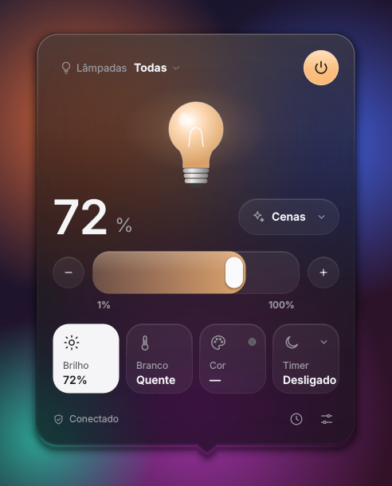
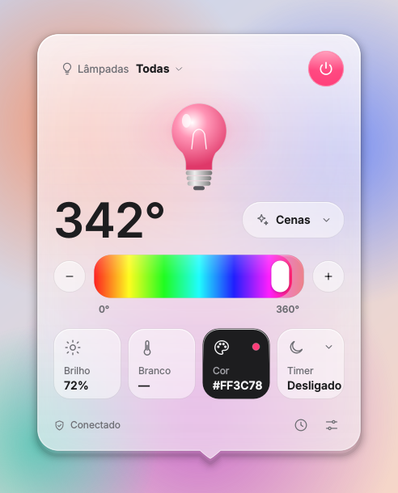
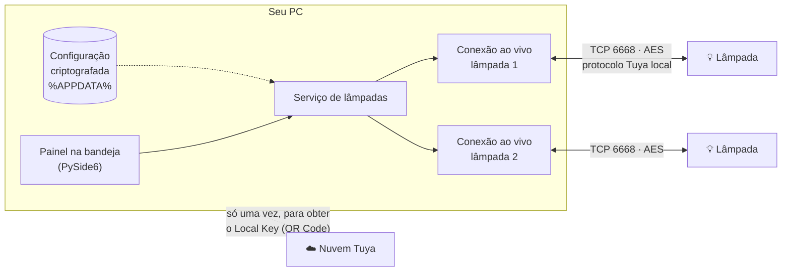
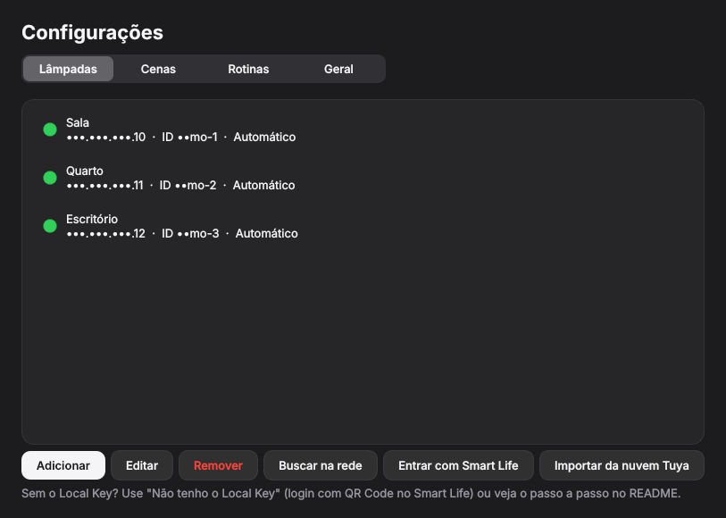

<div align="center">

# 💡 Elgin Lamp

**Controle suas lâmpadas inteligentes direto da bandeja do Windows: na hora, pela rede local e sem nuvem.**

[English](README.md) · **Português**

[](https://github.com/edugaspars/elgin-lamp/actions/workflows/ci.yml)
[](LICENSE)





</div>

---

## Por que existe

Lâmpadas inteligentes são ótimas até você precisar delas **no computador**. Pegar o celular, desbloquear, abrir o app, esperar carregar… só para diminuir a luz durante uma reunião ou um filme.

O **Elgin Lamp** coloca suas lâmpadas a **um clique**, ao lado do relógio do Windows. Ele fala **diretamente com a lâmpada pela sua rede Wi-Fi**: sem passar pela nuvem, sem atraso e funcionando mesmo com a internet fora do ar.

## Para quem é

- **Donos de lâmpadas Wi-Fi da Elgin** (linha Elgin Smart) que passam o dia no computador.
- **Qualquer lâmpada baseada na plataforma Tuya**, como as dos apps *Smart Life* e *Tuya Smart*. É a mesma tecnologia de dezenas de marcas vendidas no Brasil e no mundo.
- **Quem trabalha ou joga no PC** e quer ajustar a luz sem pegar o celular.
- **Quem se preocupa com privacidade** e prefere que o controle diário não dependa de servidores de terceiros.
- **Curiosos e desenvolvedores** que querem um exemplo real de app de bandeja em Python com protocolo Tuya local.

> Não precisa saber programar: baixe o `.exe` e siga o passo a passo.

## Recursos

| | |
|---|---|
| ⚡ **Tempo real** | Os comandos chegam à lâmpada em milissegundos. Mudanças feitas pela Alexa, pelo app ou pelo interruptor aparecem no painel na hora. |
| 🎛️ **Controle completo** | Liga/desliga, brilho, temperatura do branco (quente ↔ frio) e cor (RGB). |
| 💡 **Várias lâmpadas** | Controle cada lâmpada ou todas de uma vez. |
| 🫧 **Visual de vidro** | Temas escuro e claro, com um painel de vidro fosco que desfoca o que está atrás e brilha na cor da lâmpada. Fundo Mica no Windows 11 e opção *Reduzir transparência*. |
| 🎬 **Cenas** | Leitura, Relaxar, Foco, Noite, Cinema… e as suas. |
| ⏰ **Rotinas** | Por horário e dia da semana ou pelo **nascer/pôr do sol**, com deslocamento em minutos. |
| 🌙 **Timer** | "Desligar em 30 minutos". |
| 🔐 **Privacidade** | IP e chaves ficam só no seu PC, **criptografados**. Nada vai para o repositório. |
| 🔑 **Configuração fácil** | Busca as lâmpadas na rede e obtém a chave com um **QR Code** no Smart Life. |
| 🌎 **Português e inglês** | Detecta o idioma do sistema, e você pode trocar quando quiser. |
| 🚀 **Inicia com o Windows** | Fica discreto na bandeja, pronto para usar. |

## Como funciona



1. **Protocolo local.** Lâmpadas Elgin e outras da plataforma Tuya aceitam comandos pela rede local (porta TCP 6668), criptografados com AES usando uma chave própria de cada lâmpada, o **Local Key**. O app usa a biblioteca [tinytuya](https://github.com/jasonacox/tinytuya) para montar essas mensagens e é compatível com os protocolos 3.1 a 3.5.
2. **Conexão ao vivo.** Cada lâmpada tem uma conexão aberta o tempo todo, numa thread própria:
   - os comandos são enviados sem esperar resposta, e o painel muda na hora;
   - a lâmpada avisa quando muda de estado, o que mantém tudo sincronizado com a Alexa e o app do celular;
   - um "ping" a cada 10 s mantém a conexão viva, e ela se reconecta sozinha se a rede cair.
3. **O Local Key.** Ele é criado quando a lâmpada é pareada no app do celular e fica guardado na nuvem da Tuya. O Elgin Lamp o busca **uma única vez**, com um QR Code escaneado no app Smart Life. Depois disso, a nuvem não é mais usada.
4. **Seus dados.** IP, Device ID e Local Key ficam num único arquivo em `%APPDATA%\ElginLamp`:
   - no Windows, ele é criptografado com o **DPAPI**, então só a sua conta de usuário consegue abri-lo;
   - no Linux, é criptografado com **Fernet (AES)**, com a chave guardada no chaveiro do sistema.

## Instalação

### Windows (recomendado)

1. Abra a aba **[Actions](https://github.com/edugaspars/elgin-lamp/actions/workflows/ci.yml)**, entre na execução mais recente com ✅ e baixe o artefato **ElginLamp-windows**.
2. Extraia o `ElginLamp.exe` para uma pasta fixa, por exemplo `%LOCALAPPDATA%\Programs\ElginLamp`.
3. Abra o `.exe`. Se o Windows SmartScreen avisar, clique em **Mais informações › Executar assim mesmo** (o executável não tem assinatura digital paga).
4. Se o Firewall perguntar, permita em **Redes privadas**. É isso que permite encontrar as lâmpadas na rede.

O ícone 💡 aparece perto do relógio. Se estiver escondido, clique na setinha **^** e arraste-o para a barra.

<details>
<summary><b>Gerar o .exe você mesmo</b></summary>

Requer [Python 3.10+](https://www.python.org/downloads/).

```bat
git clone https://github.com/edugaspars/elgin-lamp.git
cd elgin-lamp
build_windows.bat
```

O script cria um ambiente virtual, roda os testes e gera `dist\ElginLamp.exe`.
</details>

<details>
<summary><b>Rodar com Python (Windows ou Linux)</b></summary>

```bash
pip install -r requirements.txt
python -m elgin_lamp          # no Windows, use pythonw para não abrir console
python -m elgin_lamp --demo   # lâmpadas simuladas, para conhecer o app
```

No Linux com **GNOME**, o ícone da bandeja precisa da extensão *AppIndicator and KStatusNotifierItem Support*.
</details>

## Primeiros passos

### 1. A lâmpada precisa estar no app Smart Life

O login por QR Code funciona com contas do **Smart Life** ou do **Tuya Smart**. Se a sua lâmpada está no **app da Elgin**, mova-a (leva uns 10 minutos):

1. No app da Elgin, abra a lâmpada e escolha **Remover dispositivo**.
2. Ligue e desligue a lâmpada no interruptor 3 vezes, até ela **piscar rápido**.
3. No **Smart Life**, toque em **+ › Adicionar dispositivo**, com o celular no Wi-Fi **2,4 GHz**.
4. **Alexa/Google:** ative a skill **Smart Life** e peça para descobrir dispositivos.

### 2. Adicione a lâmpada no Elgin Lamp

1. Clique no ícone 💡 e depois em **Adicionar lâmpada**.
2. Use **Buscar na rede** para preencher o IP e o Device ID.
3. Clique em **Não tenho o Local Key**:
   - no Smart Life, copie seu **Código do usuário** em *Eu › ⚙ Configurações › Conta e segurança*;
   - cole o código no Elgin Lamp e clique em **Gerar QR Code**;
   - no Smart Life, abra a aba **Eu**, toque no ícone de leitor (canto superior direito), escaneie e confirme no celular.
4. Clique em **Testar conexão** e depois em **Salvar**. Pronto!



> 💡 **Dica:** reserve um IP fixo para cada lâmpada no seu roteador (reserva DHCP). Se o IP mudar, **Buscar na rede** atualiza a lâmpada já cadastrada.

<details>
<summary><b>Alternativa: plataforma oficial de desenvolvedor da Tuya</b></summary>

O login por QR Code usa o mesmo mecanismo da integração oficial da Tuya no **Home Assistant** (biblioteca `tuya-device-sharing-sdk`). Se um dia a Tuya desativar esse caminho:

1. Crie uma conta gratuita em [iot.tuya.com](https://iot.tuya.com).
2. Vá em **Cloud › Development › Create Cloud Project**:
   - Smart Home;
   - Data Center **Western America** para contas do Brasil.
3. Em **Devices › Link App Account**, escaneie o QR Code com o Smart Life.
4. Copie o **Access ID** e o **Access Secret** da aba *Overview*.
5. No Elgin Lamp, use **Configurações › Lâmpadas › Importar da nuvem Tuya** (região `us`).

As credenciais não são salvas.
</details>

## Uso

| Ação | Como |
|---|---|
| Abrir o painel | Clique esquerdo no ícone 💡 |
| Ligar/desligar todas | Clique do meio no ícone |
| Menu rápido (lâmpadas, cenas, configurações) | Clique direito no ícone |
| Trocar o que o slider controla | Clique nos cards **Brilho**, **Branco** ou **Cor** |
| Escolher uma cor exata | Clique de novo no card **Cor** |
| Rotinas e nascer/pôr do sol | Ícone ⏰ no rodapé do painel |

### Linha de comando

Para atalhos e scripts, usando as lâmpadas já cadastradas (sem digitar IP nem chave):

```bat
python -m elgin_lamp.cli status
python -m elgin_lamp.cli on --lamp Sala
python -m elgin_lamp.cli brightness 40
python -m elgin_lamp.cli off
```

> Muitas lâmpadas Tuya aceitam **uma conexão local por vez**. Com o app aberto, a linha de comando pode não conseguir conectar.

## Privacidade e segurança

- **Nenhum dado seu fica no projeto.** Tudo fica em `%APPDATA%\ElginLamp\config.dat`, criptografado para a sua conta de usuário (DPAPI no Windows; Fernet + keyring no Linux).
- **Logs sem segredos:** os IDs aparecem mascarados (`••••a9c3`), e IP e chaves nunca são registrados.
- **Login no Smart Life só uma vez:** a sessão é encerrada logo após buscar as chaves, e nada da conta é salvo.
- **Proteção contra vazamentos no Git:**
  - o `.gitignore` bloqueia arquivos sensíveis;
  - um hook de pre-commit e o CI recusam commits com IPs locais, Local Keys ou arquivos do `tinytuya wizard` (`devices.json`, `tinytuya.json`).

> **E se o Local Key vazar?** Quem tiver o Local Key e o Device ID consegue controlar a lâmpada **de dentro da sua rede**. Não é o fim do mundo, mas por isso tudo é criptografado. Se suspeitar de vazamento, parear a lâmpada de novo gera uma chave nova.

## Solução de problemas

| Sintoma | O que fazer |
|---|---|
| "Sem conexão" | O PC precisa estar na mesma rede da lâmpada. Confira o IP com **Buscar na rede**. |
| A busca na rede não acha nada | Permita o app no Firewall do Windows em **redes privadas** (portas UDP 6666, 6667 e 7000) e confirme que a rede está marcada como *Privada*. |
| Erro de chave / não obedece | O Local Key muda quando a lâmpada é pareada de novo: busque-o outra vez. |
| Rotina não rodou | As rotinas rodam com o app aberto: ative **Iniciar com o sistema**. Depois de uma suspensão, a rotina ainda roda em até 10 minutos. |
| Funciona às vezes | Feche outras integrações locais (Home Assistant/LocalTuya), porque a lâmpada aceita poucas conexões ao mesmo tempo. |

Os logs ficam em `%APPDATA%\ElginLamp\elgin-lamp.log`. Para log detalhado, use `--verbose`.

## Para desenvolvedores

```bash
git clone https://github.com/edugaspars/elgin-lamp.git && cd elgin-lamp
pip install -r requirements-dev.txt
git config core.hooksPath .githooks      # ativa o bloqueio de vazamentos
python -m pytest -q                      # 45 testes, inclui uma lâmpada Tuya simulada por TCP
python -m elgin_lamp --demo              # roda sem hardware
```

```
elgin_lamp/
  app.py          bandeja, instância única, rotinas
  lamp.py         protocolo Tuya: LiveBulb (conexão ao vivo), TuyaBulb, lâmpada simulada
  service.py      ponte entre as conexões e a interface Qt
  storage.py      modelo de dados + arquivo criptografado
  crypto.py       DPAPI (Windows) / Fernet + keyring (Linux)
  scheduler.py    rotinas, nascer/pôr do sol (astral)
  discovery.py    busca na rede, login Smart Life (QR), nuvem Tuya
  geo.py          cidades offline + localização do Windows
  i18n.py         português / inglês
  cli.py          linha de comando
  ui/             painel, componentes desenhados à mão, configurações, bandeja
tests/            pytest, incluindo fake_tuya.py (lâmpada Tuya 3.3 simulada)
```

### Contribuindo

Contribuições são bem-vindas! Algumas ideias:

- suporte a mais tipos de dispositivo Tuya (tomadas, fitas LED);
- atalhos de teclado globais;
- instalador (MSI/winget) e assinatura do executável;
- mais idiomas (veja `elgin_lamp/i18n.py`).

Abra uma *issue* descrevendo a ideia ou o problema. Pull requests precisam passar no CI (testes + verificação de segredos).

## Créditos

Construído com [tinytuya](https://github.com/jasonacox/tinytuya), [PySide6 (Qt)](https://doc.qt.io/qtforpython-6/), [astral](https://github.com/sffjunkie/astral), [tuya-device-sharing-sdk](https://github.com/tuya/tuya-device-sharing-sdk) e [qrcode](https://github.com/lincolnloop/python-qrcode). Obrigado a quem mantém esses projetos.

## Aviso

Projeto independente e não oficial. **Não é afiliado, endossado ou suportado pela Elgin S.A. nem pela Tuya Inc.** "Elgin", "Tuya" e "Smart Life" são marcas de seus respectivos donos e são citadas apenas para identificar a compatibilidade. Use por sua conta e risco.

## Licença

[MIT](LICENSE) © edugaspars
